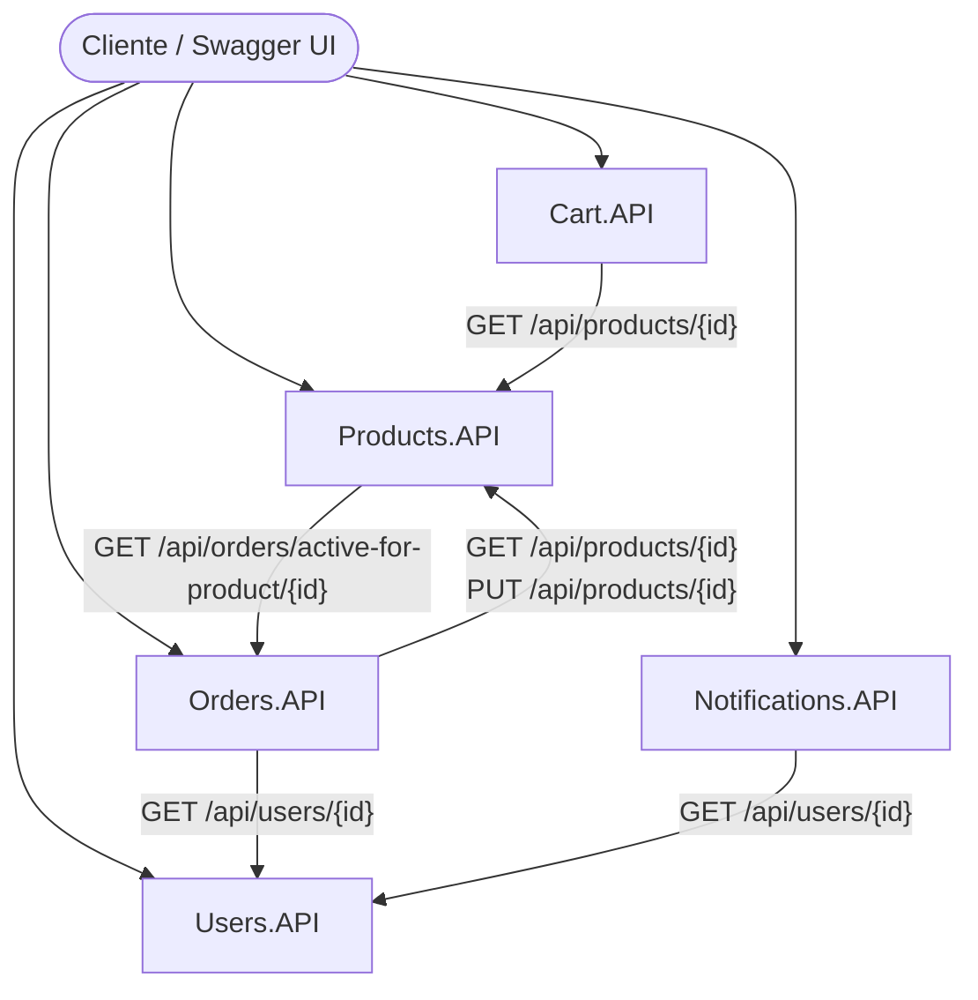

# E-Commerce Microservices (.NET Core 10)

Trabajo Práctico para la materia **Arquitectura y Diseño de Software** (Grupo 22).

Este proyecto implementa un sistema de E-Commerce basado en una arquitectura de microservicios, exponiendo funcionalidades a través de REST APIs independientes construidas con ASP.NET Core 10.

---

## 1. Diagrama de Arquitectura



> *Nota: También podés visualizar el esquema estático en [docs/architecture.png](docs/architecture.png).*

---

## 2. Descripción de Microservicios, Puertos y Rutas

| Microservicio | Descripción y Responsabilidad | Puerto HTTP | Puerto HTTPS | Swagger UI | Health Checks |
| :--- | :--- | :--- | :--- | :--- | :--- |
| **Products.API** | Gestión de catálogo de productos, categorías, precios y validación de inventario en tiempo real. | `http://localhost:5110` | `https://localhost:7046` | `/swagger` | `/health`, `/health/ready`, `/health/live` |
| **Users.API** | Registro, login, hashing seguro de credenciales y lógica de bloqueo por intentos fallidos o fraude. | `http://localhost:5112` | `https://localhost:7048` | `/swagger` | `/health`, `/health/ready`, `/health/live` |
| **Orders.API** | Creación y seguimiento de órdenes de compra, control de transiciones de estado y descuento sincrónico de stock. | `http://localhost:5114` | `https://localhost:7050` | `/swagger` | `/health`, `/health/ready`, `/health/live` |
| **Cart.API** | Administración de carritos de compras por usuario y validación de existencias con catálogo. | `http://localhost:5116` | `https://localhost:7052` | `/swagger` | `/health`, `/health/ready`, `/health/live` |
| **Notifications.API** | Registro y simulación de despacho de notificaciones (Email, Push, SMS) asociadas a eventos del sistema. | `http://localhost:5118` | `https://localhost:7054` | `/swagger` | `/health`, `/health/ready`, `/health/live` |

---

## 3. Catálogo Global de Errores

El sistema implementa el estándar **RFC 7231 (Problem Details)** para todas las respuestas de error (4xx y 5xx), incluyendo siempre `errorCode`, `errorMessage` y `correlationId` para trazabilidad distribuida.

### Products.API (`PRD`)
| Código | HTTP Status | Descripción |
| :--- | :--- | :--- |
| `PRD-001` | 404 Not Found | Producto no encontrado por ID. |
| `PRD-002` | 400 Bad Request | Datos inválidos (precio <= 0, stock negativo, campos vacíos). |
| `PRD-003` | 409 Conflict | Nombre duplicado dentro de la misma categoría. |
| `PRD-004` | 409 Conflict | El producto tiene órdenes activas (Pendiente/Confirmada) y no puede eliminarse. |
| `PRD-005` | 500 Server Error | Error no controlado o fallo interno de persistencia. |

### Users.API (`USR`)
| Código | HTTP Status | Descripción |
| :--- | :--- | :--- |
| `USR-001` | 409 Conflict | El email ya se encuentra registrado. |
| `USR-002` | 400 Bad Request | Datos de usuario inválidos o formato de email incorrecto. |
| `USR-003` | 401 Unauthorized | Credenciales incorrectas (email o contraseña inválidos). |
| `USR-004` | 403 Forbidden | Cuenta bloqueada tras acumular 3 intentos fallidos consecutivos. |
| `USR-005` | 403 Forbidden | Cuenta bloqueada por detección preventiva de fraude. |
| `USR-006` | 500 Server Error | Error interno al procesar el usuario. |

### Orders.API (`ORD`)
| Código | HTTP Status | Descripción |
| :--- | :--- | :--- |
| `ORD-001` | 404 Not Found | Orden no encontrada por ID. |
| `ORD-002` | 400 Bad Request | Datos inválidos (lista de ítems vacía o cantidades <= 0). |
| `ORD-003` | 404 Not Found | Usuario no encontrado o inactivo al crear la orden. |
| `ORD-004` | 404 Not Found | Uno o más productos solicitados no existen en el catálogo. |
| `ORD-005` | 422 Unprocessable | Stock insuficiente para completar la cantidad pedida. |
| `ORD-006` | 409 Conflict | Transición de estado no permitida (ej. revertir orden Entregada o Cancelada). |
| `ORD-007` | 500 Server Error | Error no controlado al procesar la orden. |

### Cart.API (`CRT`)
| Código | HTTP Status | Descripción |
| :--- | :--- | :--- |
| `CRT-001` | 404 Not Found | El usuario no posee un carrito activo. |
| `CRT-002` | 404 Not Found | Producto no encontrado en el catálogo. |
| `CRT-003` | 422 Unprocessable | Stock insuficiente para la cantidad deseada. |
| `CRT-004` | 400 Bad Request | Cantidad solicitada menor o igual a cero. |
| `CRT-005` | 500 Server Error | Error no controlado al procesar el carrito. |

### Notifications.API (`NTF`)
| Código | HTTP Status | Descripción |
| :--- | :--- | :--- |
| `NTF-001` | 404 Not Found | Usuario destinatario no encontrado en Users.API. |
| `NTF-002` | 400 Bad Request | Datos inválidos, canal no soportado o destinatario inactivo. |
| `NTF-003` | 404 Not Found | No se encontraron notificaciones registradas para el usuario. |
| `NTF-004` | 500 Server Error | Error interno al procesar la notificación. |

---

## 4. Guía de Ejecución

### Prerrequisitos
- [.NET 10 SDK](https://dotnet.microsoft.com/)
- SQLite (las bases de datos `.db` se inicializan automáticamente al arrancar cada servicio).

### Orden de inicio recomendado
Para probar el ciclo transaccional completo y la comunicación inter-servicio, levantar las APIs en el siguiente orden:
1. `Users.API` (Puerto 5112 / 7048)
2. `Products.API` (Puerto 5110 / 7046)
3. `Orders.API` (Puerto 5114 / 7050)
4. `Cart.API` (Puerto 5116 / 7052)
5. `Notifications.API` (Puerto 5118 / 7054)

### Ejecución por consola
Cada microservicio puede ejecutarse de manera independiente:

```bash
# Ejemplo ejecutando Products.API (utilizar la ruta según la raíz del repositorio)
dotnet run --project Products.API --launch-profile https
```

*(Si se ejecuta directamente desde la carpeta del proyecto: `cd Products.API && dotnet run --launch-profile https`).*

---

## 5. Observabilidad y Diagnóstico

- **Health Checks:**
  - `GET /health`: Estado general del servicio.
  - `GET /health/ready`: Estado de dependencias críticas (base de datos SQLite).
  - `GET /health/live`: Verifica que el proceso esté activo y respondiendo.
- **Logging Estructurado con Serilog:**
  - Consola: Salida limpia y formateada para depuración local y presentación.
  - Archivos: JSON estructurado persistido diariamente en `logs/audit-YYYYMMDD.json` con metadatos requeridos: `Timestamp`, `Level`, `Servicio`, `CorrelationId`, endpoints y códigos de error.
- **Trazabilidad Distribuida:** Encabezado `X-Correlation-Id` autogenerado o propagado en llamadas salientes vía HTTP Handlers.

---

## 6. Documentación Entregable y Evidencias

En la carpeta [`docs/`](docs/) se encuentran disponibles:
- `architecture.png`: Diagrama visual estático de la arquitectura de microservicios.
- Capturas de Swagger UI documentando respuestas exitosas y casos de error con sus respectivos `errorCode`, `errorMessage` y `correlationId`.