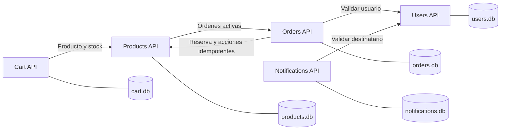

# ECommerce del Grupo 22

Trabajo práctico de arquitectura de microservicios en C# y ASP.NET Core 10. Las cinco APIs mantienen sus datos en bases SQLite independientes y se comunican mediante `IHttpClientFactory`. **SQLite/Dapper fue una decisión autorizada por la cátedra**, según la confirmación del grupo; no falta incorporar otra librería de persistencia.

## Preparación y ejecución

Requisitos: SDK .NET 10, conexión a NuGet para la primera restauración y cinco terminales. Python 3 solo es necesario para ejecutar la suite HTTP de regresión.

Desde la carpeta del repositorio:

```powershell
dotnet restore ECommerce.sln
dotnet build ECommerce.sln
```

Ejecutar cada comando en una terminal independiente, desde la raíz:

```powershell
dotnet run --no-build --project src/Users.API --launch-profile http
dotnet run --no-build --project src/Products.API --launch-profile http
dotnet run --no-build --project src/Orders.API --launch-profile http
dotnet run --no-build --project src/Cart.API --launch-profile http
dotnet run --no-build --project src/Notifications.API --launch-profile http
```

Levantar las cinco antes de verificar readiness. Products y Orders tienen consultas cruzadas; durante el arranque de la otra API es esperable que readiness informe Unhealthy. La creación de tablas y las migraciones se ejecutan al iniciar cada proceso. No hace falta ejecutar scripts SQL manuales.

| Servicio | Puerto HTTP | Swagger | Función y dependencias |
|---|---:|---|---|
| Products.API | 5110 | [Abrir](http://localhost:5110/swagger) | Catálogo y reserva atómica de stock; consulta Orders para proteger el borrado. |
| Users.API | 5112 | [Abrir](http://localhost:5112/swagger) | Registro, login, bloqueo y consulta segura de usuarios. |
| Orders.API | 5114 | [Abrir](http://localhost:5114/swagger) | Órdenes, precios capturados, estados y recuperación durable; usa Users y Products. |
| Cart.API | 5138 | [Abrir](http://localhost:5138/swagger) | Cantidad acumulada y última modificación del carrito; consulta Products. |
| Notifications.API | 5118 | [Abrir](http://localhost:5118/swagger) | Registro e historial de envíos simulados; valida destinatarios con Users. |

El perfil `http` fija puerto y entorno Development. Para ejecutar una DLL publicada, configurar `ASPNETCORE_URLS` y `ASPNETCORE_ENVIRONMENT` y usar como directorio de trabajo la carpeta del servicio. Las cadenas SQLite relativas se resuelven desde ese directorio. También se puede especificar `ConnectionStrings__DefaultConnection` con una ruta absoluta.

Las URLs de integración están en `Services` de cada `appsettings.json`; se pueden reemplazar con variables como `Services__ProductsApiUrl`. Swagger está habilitado explícitamente en ambos entornos para la entrega y se puede desactivar con `Swagger__Enabled=false`. No hay secretos en los archivos de ejemplo Development/Production.

## Arquitectura y organización



```text
ECommerce.sln
src/
  Products.API/       Controllers, Services, DTOs, Models, Data, Clients, Exceptions
  Users.API/          Controllers, Services, DTOs, Models, Data, Exceptions
  Orders.API/         Controllers, Services, recuperación y outbox, datos y clientes
  Cart.API/           Controllers, Services, DTOs, Models, Data, Clients, Exceptions
  Notifications.API/ Controllers, Services, DTOs, Models, Data, Clients, Exceptions
  ECommerce.Shared/   IExceptionHandler, contrato de errores, correlación, logs y OpenAPI
tests/
  integration.py
  UsersCart.Regression/
docs/
  commerce.md
  notifications.md
  validacion.md
  screenshots/
```

Los controladores públicos tienen XML comments, validación Data Annotations y documentación OpenAPI con esquemas y ejemplos de respuestas de éxito y de error. Las reglas viven en servicios de negocio; los repositorios contienen las operaciones de persistencia. El manejo global usa `IExceptionHandler`, compartido entre las cinco APIs. Los middlewares propios solo agregan correlación y auditoría de requests; no sustituyen el manejador de errores.

## Contratos públicos

| API | Operaciones |
|---|---|
| Products | GET/POST `/api/products`; GET/PUT/DELETE `/api/products/{id}`. Filtros `categoria` y `nombre`. |
| Users | POST `/api/users/register`; POST `/api/users/login`. GET `/api/users/{id}` para integración. |
| Orders | GET/POST `/api/orders`; GET `/api/orders/{id}`; PUT `/api/orders/{id}/status`. Filtro `usuarioId`. |
| Cart | GET/DELETE `/api/cart/{userId}`; POST `/api/cart/{userId}/items`; PUT/DELETE `/api/cart/{userId}/items/{productId}`. |
| Notifications | POST `/api/notifications/send`; GET `/api/notifications/{userId}`. |

Las categorías de productos son informativas: se admite cualquier categoría no vacía. El carrito no reserva stock; valida la cantidad acumulada frente al stock consultado. Un carrito sin ítems se considera inactivo y devuelve CRT-001. `FechaActualizacion` se persiste al modificarlo y no cambia con GET.

El login resetea fallos tras una clave correcta y bloquea al tercer error consecutivo. El bloqueo manual con menos de tres fallos corresponde a USR-005. Las respuestas nunca incluyen PasswordHash. Los usuarios nuevos guardan hashes con salt mediante `PasswordHasher<User>`; las cuentas heredadas en Base64 se migran después de un login correcto, sin registrar la clave.

Notifications simula el envío localmente: acepta Email, Push o SMS y persiste `Estado=Enviada` y `FechaEnvio`. No envía correos o SMS reales. Un historial vacío devuelve NTF-003/404. Las notificaciones históricas se consultan localmente, incluso si luego se bloquea el usuario o Users.API está caída.

## Integridad de órdenes y stock

Los productos repetidos se agrupan antes de validar su cantidad total. Products reserva todos los ítems en una única transacción con actualización condicional de stock. No se actualiza el producto completo para descontar unidades. La orden y sus ítems se guardan en una transacción local; las acciones pendientes de inventario se registran en un outbox durable.

Para reintentar un POST sin duplicarlo, enviar un GUID propio en `Idempotency-Key` y conservarlo. La misma clave y los mismos datos devuelven la misma orden; usarla con otros datos produce ORD-008/409. Si no se envía clave, el servidor genera una y la devuelve al crear la orden. Ante una conexión interrumpida antes de recibir respuesta, una clave enviada por el cliente permite identificar el intento.

Matriz de estados:

| Estado actual | Cambios permitidos |
|---|---|
| Pendiente | Confirmada o Cancelada |
| Confirmada | Enviada o Cancelada |
| Enviada | Entregada |
| Entregada / Cancelada | Ningún cambio a otro estado |

Repetir el mismo estado es idempotente. Las transiciones usan comparación del estado previo para evitar carreras. Cancelar una orden nueva libera su reserva una sola vez; las órdenes históricas anteriores al mecanismo no reciben reintegros inventados.

La recuperación se ejecuta periódicamente y tras reinicios. Las compensaciones son **eventuales** si Products está caída: no se promete una transacción distribuida instantánea. Una intención fallida conserva su resultado; para un nuevo intento lógico se usa una nueva clave. Ver [detalles de reservas, fallas y recuperación](docs/commerce.md).

Los endpoints `/internal/stock/reservations/{orderId}` y `/api/orders/active-for-product/{productId}` son de integración y están documentados en ese archivo. El TP no requiere autenticación de infraestructura; esta solución educativa no implementa permisos para una publicación pública.

## Errores y observabilidad

Formato común de error, sin stack traces:

```json
{
  "type": "https://www.rfc-editor.org/rfc/rfc9110",
  "title": "Not Found",
  "status": 404,
  "detail": "Producto no encontrado.",
  "instance": "/api/products/99",
  "errorCode": "PRD-001",
  "errorMessage": "Producto no encontrado.",
  "correlationId": "21dfd900f4db49d8a0136f91d16350ad"
}
```

Cada request acepta `X-Correlation-Id` o genera uno; se propaga a las llamadas salientes, los logs y las respuestas. Se conservan el header y el campo del error incluso cuando interviene el manejador de excepciones. El archivo Serilog `logs/audit-YYYYMMDD.jsonl` contiene un objeto JSON por línea, con Timestamp, Level, Servicio, Endpoint, CorrelationId y ErrorCode cuando corresponde. Se registran inicio, fin y duración; negocio como Warning y fallas inesperadas como Error. La consola muestra un formato legible.

| Ruta en cada API | Qué comprueba |
|---|---|
| `/health/live` | Proceso vivo. |
| `/health/local` | Proceso y almacenamiento propios; usada entre dependencias para evitar ciclos. |
| `/health/ready` | Almacenamiento y dependencias necesarias. |
| `/health` | Reporte agregado con estado y duración de los checks. |
| `/health-ui` | Vista adicional de monitoreo. |

Los reportes de salud usan su contrato JSON `status/entries/totalDuration` y devuelven 503 cuando corresponda; los errores de las APIs funcionales usan el contrato de error anterior. La configuración del nivel de logs está separada por entorno; los detalles internos de excepciones permanecen en logs y no se devuelven al cliente.

## Catálogo de errores

| Código | HTTP | Significado |
|---|---:|---|
| PRD-001 | 404 | Producto no encontrado. |
| PRD-002 | 400 | Los datos del producto son inválidos. |
| PRD-003 | 409 | Ya existe un producto con ese nombre en la categoría. |
| PRD-004 | 409 | El producto tiene órdenes activas y no puede eliminarse. |
| PRD-005 | 500 | Error interno al procesar el producto. |
| PRD-006 | 422 | Stock insuficiente para reservar los productos. |
| PRD-007 | 409 | La reserva de stock no admite esta operación. |
| USR-001 | 409 | El email ya está registrado. |
| USR-002 | 400 | Los datos del usuario son inválidos. |
| USR-003 | 401 | Credenciales incorrectas. |
| USR-004 | 403 | Usuario bloqueado por demasiados intentos fallidos. |
| USR-005 | 403 | Usuario bloqueado por detección de fraude. |
| USR-006 | 500 | Error interno al procesar el usuario. |
| USR-007 | 404 | Usuario no encontrado. |
| ORD-001 | 404 | Orden no encontrada. |
| ORD-002 | 400 | Los datos de la orden son inválidos. |
| ORD-003 | 404 | Usuario no encontrado al crear la orden. |
| ORD-004 | 404 | Producto no encontrado al crear la orden. |
| ORD-005 | 422 | Stock insuficiente para uno o más productos. |
| ORD-006 | 409 | El estado de la orden no puede ser modificado. |
| ORD-007 | 500 | Error interno al procesar la orden. |
| ORD-008 | 409 | La clave de idempotencia ya se usó para otra solicitud. |
| CRT-001 | 404 | Carrito no encontrado. |
| CRT-002 | 404 | Producto no encontrado. |
| CRT-003 | 422 | Stock insuficiente para agregar al carrito. |
| CRT-004 | 400 | Cantidad o identificador inválido. |
| CRT-005 | 500 | Error interno al procesar el carrito. |
| NTF-001 | 404 | Usuario no encontrado. |
| NTF-002 | 400 | Los datos de la notificación son inválidos. |
| NTF-003 | 404 | No se encontraron notificaciones para el usuario. |
| NTF-004 | 500 | Error interno al procesar la notificación. |

PRD-006, PRD-007, USR-007 y ORD-008 son extensiones documentadas del catálogo original para reservas, consulta interna e idempotencia. Los errores generales de protocolo/routing, que no tienen un código de negocio específico, usan `HTTP-404`, `HTTP-405`, `HTTP-415`, etc., con el mismo cuerpo. Los errores de JSON y validación de cada recurso usan su código de datos inválidos.

## Datos y migraciones

Las bases pequeñas preexistentes se conservan. Para una demo reproducible conviene crear un usuario y productos desde Swagger y reutilizar los IDs devueltos. No publicar contraseñas personales en datos de prueba.

Las migraciones son transaccionales e idempotentes: mantienen IDs, ítems y fechas existentes; agregan estructuras de carrito, reservas, recuperación y columnas de importes exactos. Los importes nuevos se leen desde representación decimal exacta y no dependen de REAL. La precisión que ya se hubiera perdido en un registro antiguo no puede reconstruirse. Si una base antigua contiene emails o productos duplicados después de normalizar, se detiene la migración sin borrar registros; se deben resolver esos duplicados con el grupo antes de reiniciar.

Las consultas están parametrizadas. Los locks SQLite y las transacciones protegen las operaciones locales; la comunicación entre bases independientes se resuelve con reservas/outbox, no compartiendo una conexión o consultando bases ajenas.

## Pruebas y defensa

Después de compilar:

```powershell
python tests/integration.py
dotnet build tests/UsersCart.Regression/UsersCart.Regression.csproj
dotnet tests/UsersCart.Regression/bin/Debug/net10.0/UsersCart.Regression.dll
```

La suite HTTP inicia procesos temporales en puertos 261xx y crea bases/logs descartables bajo `.test-runs`. No utiliza ni modifica las bases versionadas. Se deben dejar libres esos puertos. Se puede conservar diagnóstico con `--keep-data` y elegir el reporte mediante `--output`. El runner Users/Cart verifica también migración y concurrencia directamente sobre persistencia temporal. Los resultados de la revisión están en [validación](docs/validacion.md).

[Capturas reales de Swagger con respuestas de error](docs/screenshots/README.md). Para la defensa de 15–20 minutos: presentar arquitectura y responsabilidades; registrar usuario y producto; crear y consultar una orden; mostrar stock y transiciones; provocar PRD-001, ORD-005, CRT-004 y NTF-003; mostrar el mismo Correlation ID en respuesta y logs; verificar `/health/ready` y `/health/live`. Todos los integrantes deben poder explicar cualquier servicio, la reserva de stock y la recuperación ante fallas.
