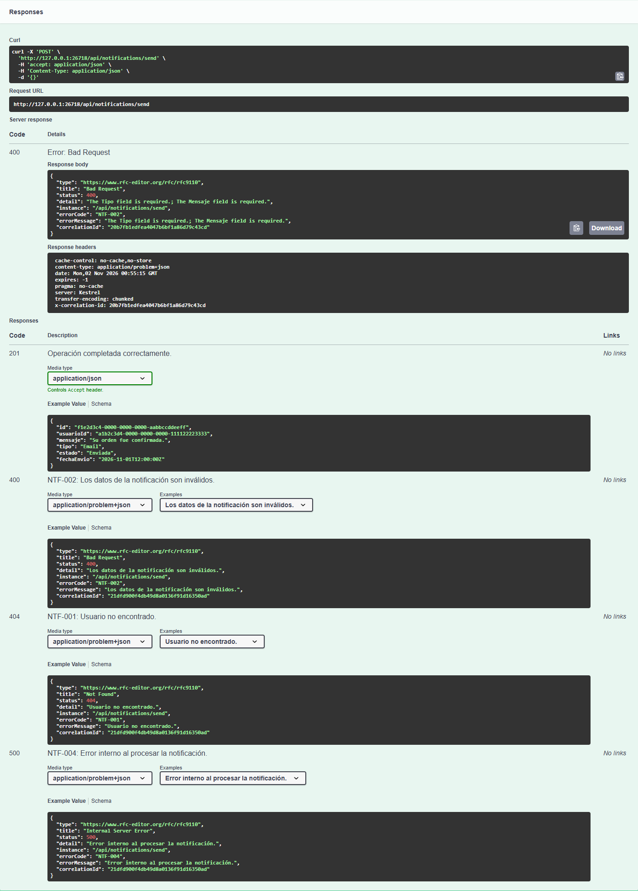
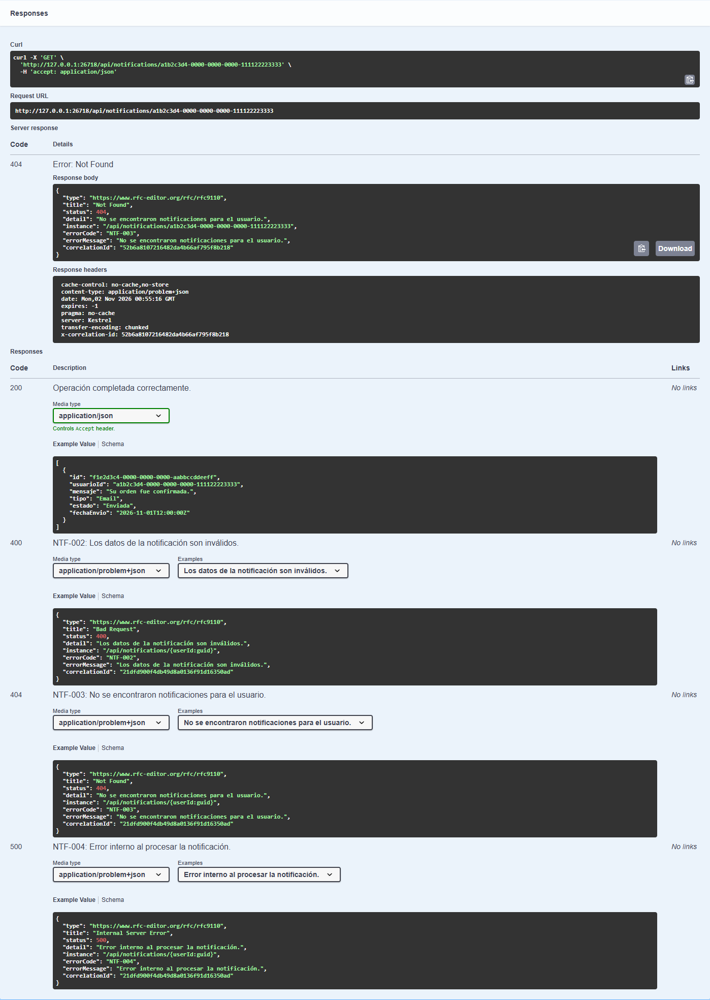

# Capturas de Swagger UI

Las imágenes muestran respuestas reales ejecutadas desde **Try it out → Execute** en Swagger UI. Se usaron procesos locales y bases temporales vacías; los identificadores son datos sintéticos. Los puertos de captura fueron 26712 para Users y 26718 para Notifications, independientes de los puertos habituales del README.

## Datos de notificación inválidos

`POST /api/notifications/send` con body `{}` devuelve HTTP **400**, `errorCode: "NTF-002"` y `errorMessage`. La respuesta incluye también Correlation ID en el cuerpo y el header. Debajo del resultado real se ven los ejemplos de respuesta documentados por OpenAPI.

## Historial sin notificaciones

`GET /api/notifications/a1b2c3d4-0000-0000-0000-111122223333` en una base vacía devuelve HTTP **404**, `errorCode: "NTF-003"` y el mensaje correspondiente. La consulta de historial no requiere que Users.API responda.

Las capturas se tomaron el 1 de noviembre de 2026, hora de Buenos Aires; el header HTTP `Date` utiliza UTC y puede mostrar el día siguiente.
